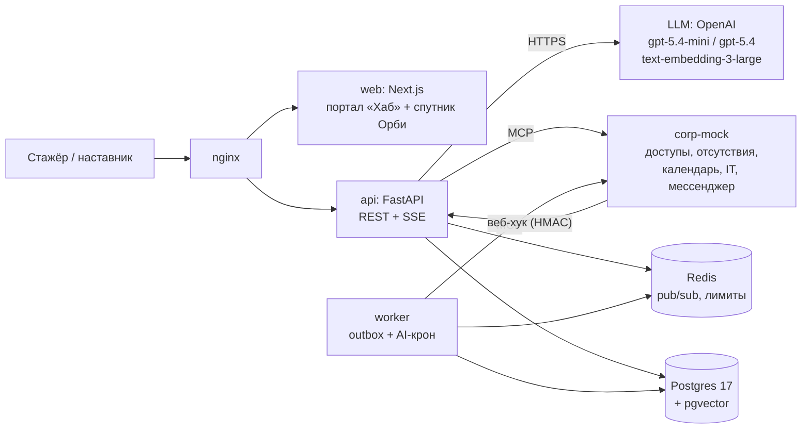
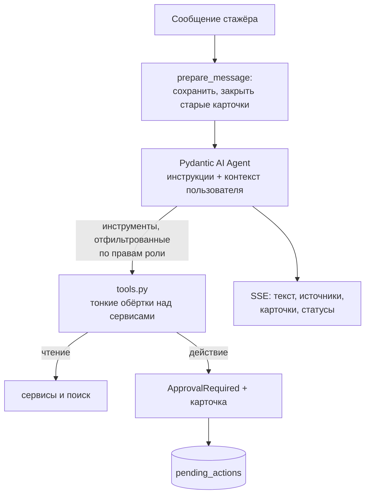
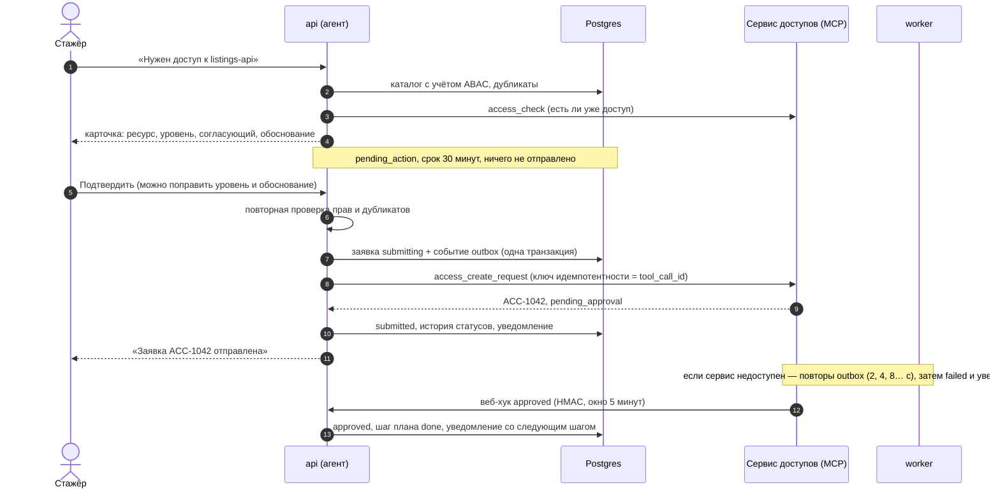

# Архитектура Орби

Как устроены бэкенд, агент и интеграции и почему именно так. Решения с альтернативами собраны в
[DECISIONS.md](DECISIONS.md), требования — в [case/CASE_BRIEF.md](case/CASE_BRIEF.md), сценарии —
в [../specs/](../specs/).

## 1. Компоненты

| Сервис | Ответственность |
|---|---|
| `api` | HTTP API, агент Орби (запуск в запросе, стриминг SSE), веб-хуки корпоративных сервисов |
| `worker` | доставка outbox (отправка заявок, realtime-события, эмбеддинги), AI-крон |
| `corp-mock` | MCP-имитация корпоративных сервисов; детерминированные решения, веб-хуки, имитация сбоев |
| `migrate` | одноразовый шаг: ключи JWT, миграции, идемпотентный сид демо-компании |

## 2. Слои бэкенда

Шаблон монолита команды: `api → service → domain`, `db` и `infra` — адаптеры.

| Слой | Что лежит | Пример |
|---|---|---|
| `domain/` | правила без фреймворков: роли и ABAC, машина состояний плана, правила отсутствий, лестница эскалаций, флаги | `plan.next_status`, `requests.resource_visible` |
| `db/` | ORM-модели, репозитории, Unit of Work | `KnowledgeRepository.full_text` с ACL в SQL |
| `infra/` | MCP-клиент, OpenAI-модели и эмбеддинги, Redis pub/sub, метрики | `McpCorpServices` |
| `service/` | сценарии: план, заявки, знания, эскалации, наставник, AI-крон, агент | `RequestService.prepare_access` |
| `api/` | роутеры, схемы, зависимости (права), SSE | `POST /chat/conversations/{id}/messages` |

Правила: одна транзакция на запрос (коммитит только владелец UoW), побочные эффекты — через outbox,
ожидаемые ошибки — `DomainError` с кодом (RFC 7807), `mypy --strict`, ничего не создаётся при импорте.

## 3. Агент

- **Одна модель на все роли.** Набор инструментов фильтруется по правам до передачи модели: стажёр
  не видит инструменты наставника, наставник не видит чужих подопечных.
- **Инструменты владеют транзакциями.** Каждый вызов открывает свой UoW, поэтому долгий стриминг не
  держит транзакцию, а изменения видны сразу.
- **История на сервере.** Сообщения Pydantic AI хранятся в `conversations.model_history`; клиент
  присылает только текст или решение по карточке и не может подделать вызов инструмента.
- **Модели.** `gpt-5.4-mini` через Responses API для OpenAI или Chat Completions для совместимых
  шлюзов, обёрнута `FallbackModel` с офлайн-моделью. Офлайн-модель (`FunctionModel`) разбирает
  намерение правилами и вызывает те же инструменты, поэтому прототип работает без ключа, а тесты —
  без сети.
- **Промпт-инъекции.** Документы и результаты инструментов — данные; системные инструкции запрещают
  исполнять команды из них. Действия возможны только через карточку, поэтому инъекция максимум
  предложит карточку, которую человек увидит.
- **Лимиты.** Не больше 8 запросов к модели и 8 вызовов инструментов за ход, 20 сообщений в минуту
  на пользователя.

## 4. Подтверждение действий

Что отправляется в сервис, где спрашивается подтверждение и как обрабатываются ошибки, по каждому
сценарию расписано в спецификациях (002, 004, 005).

## 5. Права

| Механизм | Где | Что защищает |
|---|---|---|
| RBAC | `domain/users.py`: `ROLE_PERMISSIONS` и `require(Permission.X)` | эндпоинты и набор инструментов агента |
| ABAC: люди | `can_view_member`, `can_review_member` | наставник — свои подопечные, руководитель — команда, HRBP — закреплённые |
| ABAC: ресурсы | `resource_visible` | `restricted` не видят стажёры, `confidential` — только HRBP; командные — только команда |
| ABAC: документы | фильтр в SQL до ранжирования | чужие команды и роли не попадают ни в ответ, ни в контекст модели |
| Нераскрытие | 404 вместо 403 | факт существования чужого плана, подопечного, ресурса |
| Подтверждение | `ApprovalRequired` + `pending_actions` | любое действие с последствиями, с повторной проверкой при исполнении |
| Аудит | `audit_log` | решения по карточкам, заявки, ответы, FAQ, флаги, деликатные темы |

Аутентификация из шаблона: JWT RS256 на 15 минут и ротируемый refresh в httpOnly-cookie с CSRF;
сброс сессий при бане и «выйти везде». Регистрации нет: сотрудники приходят из корпоративного SSO
(в прототипе — сид).

## 6. Знания

- Документы — Markdown с метаданными: область (компания или команда), роли, владелец, дата
  обновления, источник. Разбиваются на разделы по `##`, раздел может иметь тему (`<!-- topic: … -->`).
- Поиск — гибридный в одной базе: полнотекстовый (`russian`, OR по значимым словам) и векторный
  (pgvector, HNSW, косинус), объединение Reciprocal Rank Fusion. ACL — в `WHERE` до ранжирования.
  Без ключа — только полнотекстовый.
- Противоречия — пары разделов на одну тему (компания и команда). Владельцы базы знаний размечают их
  в документах; при наличии ключа фоновая задача спрашивает `gpt-5.4`, противоречат ли новые пары.
  Пара показывается, только если обе стороны видны читателю.
- Ответ наставника можно опубликовать в FAQ команды: появится документ, его разделы проиндексируются,
  и следующий стажёр получит ответ сразу.

## 7. Интеграции

Порт `CorpServices` (`service/ports.py`) описывает, что Орби нужно от корпоративных сервисов.
Сейчас его реализует `McpCorpServices` — MCP-клиент к `corp-mock`. Путь к реальной интеграции:

1. Адаптер к Jira Service Desk или внутреннему сервису доступов, реализующий тот же порт.
2. Веб-хук сервиса или опрос статусов через `reconcile` воркера (уже есть).
3. Инструменты Орби можно отдать во внутренний конструктор агентов Авито: это тот же набор функций
   с описаниями, правами и политикой подтверждения.

Все создания идемпотентны по ключу, веб-хуки подписаны HMAC (`X-Corp-Timestamp`,
`X-Corp-Signature`), потерянные веб-хуки догоняет сверка воркера.

## 8. Фоновые задачи (AI-крон)

| Задача | Период | Что делает |
|---|---|---|
| outbox | постоянно | отправка заявок, realtime-события, эмбеддинги; повторы с экспоненциальной задержкой, dead-letter |
| `escalations` | тик | вопрос без ответа до срока поднимается: наставник → руководитель → HRBP |
| `reconcile` | тик | спрашивает сервис о заявках, по которым не пришёл веб-хук |
| `overdue` | 10 тиков | напоминание о просроченном шаге, не чаще раза в день на шаг |
| `sla` | 10 тиков | заявка дольше срока — предложить напомнить согласующему |
| `equipment` | 20 тиков | ноутбук готов к выдаче — уведомление с местом и часами |
| `digest` | 6 часов | сводка наставнику к 1:1 (моделью или шаблоном), раз в неделю |
| `conflict-check` | 12 часов | поиск противоречий моделью |

Несколько воркеров безопасны: события забираются `SKIP LOCKED`, задачи берут advisory lock.

## 9. Наблюдаемость и метрики

- `X-Request-ID` в каждом ответе и строке лога, JSON-логи в проде.
- Prometheus (`/api/metrics`): латентность HTTP, время до первого токена, ходы агента, вызовы
  инструментов, решения по карточкам, вызовы корпоративных сервисов, фоллбэки, outbox.
- Продуктовые события в `analytics_events`; `GET /api/v1/analytics/summary` считает время до доступа,
  долю вопросов без наставника, шаги в срок, оценки ответов, по вариантам эксперимента.
- Флаги с раскаткой по командам (`domain/flags.py`): вся команда попадает в один вариант, поэтому A/B
  не смешивает наставников между группами.

## 10. Тесты

| Уровень | Что | Где |
|---|---|---|
| unit | правила домена, офлайн-модель, протокол потока, сборка моделей | `backend/tests/unit` |
| integration | каждый эндпоинт против настоящих Postgres и Redis, сценарии агента, воркер и AI-крон, MCP-адаптер против corp-mock в памяти | `backend/tests/integration` |

Корпоративные сервисы в интеграционных тестах подменяет `FakeCorpServices` с переключателями сбоев.
Схема создаётся настоящими миграциями, отдельный тест сверяет модели с миграциями.

## 11. Путь в прод

| Сейчас | В Авито |
|---|---|
| сид пользователей, вход по паролю | корпоративный SSO, роли и связи из оргструктуры |
| corp-mock по MCP | адаптеры к сервису доступов, отсутствий, IT; MCP-инструменты во внутреннем конструкторе агентов |
| outbox в Postgres | outbox → Kafka для межсервисных событий |
| AI-крон в воркере | внутренний AI-крон по событиям сервисов |
| OpenAI | A-Vibe или внутренний LLM-шлюз (OpenAI-совместимый, меняется `LLM_BASE_URL`) |
| Prometheus-метрики | Grafana-дашборды, алерты на фоллбэки и ошибки инструментов, OpenTelemetry-трейсы агента |
| флаги в таблице | корпоративный сервис флагов |
